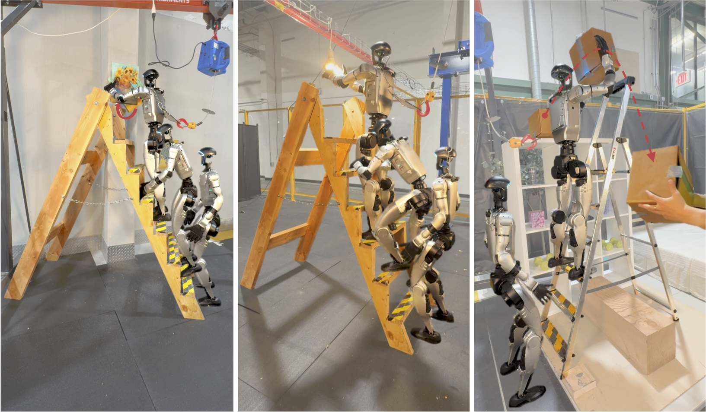

## LadderMan: Learning Humanoid Perceptive Ladder Climbing

Siheng Zhao, Yuanhang Zhang, Ziqi Lu, Pieter Abbeel, Rocky Duan, Koushil Sreenath, Yue Wang, C. Karen Liu†, Guanya Shi†
*† Equal Advising*

[](https://ladderman-robot.github.io/)

[**Website**](https://ladderman-robot.github.io/) · [**arXiv**](https://arxiv.org/abs/2606.05873) · [**Video**](https://www.youtube.com/shorts/hAB1VmZhKW4)



---

## News

- **2026-11** The code is now fully open-sourced!
- **2026-10** LadderMan is accepted by **CoRL 2026** as a **Spotlight**!
- **2026-06** LadderMan is officially released!

---

## Installation

Requirements: Linux (e.g. Ubuntu 22.04 / 24.04), an NVIDIA GPU with a recent driver, `git`, and `curl`. Isaac Lab may also need build tools:

```bash
sudo apt install -y cmake build-essential
```

Then run the one-shot setup script from the repository root:

```bash
bash setup.sh
```

`setup.sh` does the following:
- Uses your existing `conda`. If conda is not found, it installs Miniconda into `./thirdparty/miniconda3`.
- Creates the env `ladderman` with Python 3.10. Set `ENV_NAME=...` to use a different name.
- Installs Isaac Sim 4.5.0 from pip.
- Clones Isaac Lab v2.2.0 into `./thirdparty/IsaacLab` and installs it. Set `ISAACLAB_DIR=...` to reuse an existing checkout.
- Installs this repository in editable mode.

Activate the environment before running anything:

```bash
conda activate ladderman
```

The first launch of Isaac Sim asks you to accept the NVIDIA Omniverse EULA. Export `OMNI_KIT_ACCEPT_EULA=YES` to accept it non-interactively.

## Training Example

> **Note:** As a quick example for testing, this section uses only **4 teachers**: ladder inclinations 60.0°, 62.7°, 65.5° and 68.2°, all with a rung spacing of 0.25 m. You can define your own teacher coverage by training more teachers, over a grid of **inclinations × rung spacings**:
> ```bash
> # 1. teachers: one per (inclination, spacing), trained in inclination-major order
> SPACINGS="0.22 0.25 0.28" bash scripts/train_teachers.sh 57.0 61.0 65.0 69.0
> # 2. student: the same grid, and the 12 checkpoints in the same order
> #    (57.0, 0.22), (57.0, 0.25), (57.0, 0.28), (61.0, 0.22), ..., (69.0, 0.28)
> python scripts/train.py algo=student task=student \
>     task.randomization.ladder_inclination_me_randomization.inclination_deg_list=[57.0,61.0,65.0,69.0] \
>     task.randomization.ladder_inclination_me_randomization.spacing_list=[0.22,0.25,0.28] \
>     'algo.teacher_checkpoint_path_list=[<12 checkpoints>]'
> ```
> During student training, each environment is assigned one expert of the grid. It is labelled by the teacher with the closest inclination and, among those, the closest rung spacing. If your teachers do not form a full grid, give each teacher's ladder explicitly with `algo.teacher_inclination_deg_list=[...]` and `algo.teacher_spacing_list=[...]`, in the same order as the checkpoints.

All commands are run from the repository root. Outputs (config, logs, checkpoints) go to `outputs/<date>/<time>-<task>-<algo>/`, and checkpoints are saved to its `checkpoints/` subfolder every 300 iterations plus a final `checkpoint_final.pt`. The default settings (4096 envs) were used on a single NVIDIA L40S (48 GB). On smaller GPUs, reduce `task.num_envs`.

### Step 1: teachers

Train the teachers (one per inclination), sequentially on one GPU:

```bash
bash scripts/train_teachers.sh
```

Or train them one at a time, for example in parallel on different GPUs:

```bash
CUDA_VISIBLE_DEVICES=0 python scripts/train.py algo=teacher task=teacher task.command.ladder_config.inclination_deg=60.0
CUDA_VISIBLE_DEVICES=1 python scripts/train.py algo=teacher task=teacher task.command.ladder_config.inclination_deg=62.7
CUDA_VISIBLE_DEVICES=2 python scripts/train.py algo=teacher task=teacher task.command.ladder_config.inclination_deg=65.5
CUDA_VISIBLE_DEVICES=3 python scripts/train.py algo=teacher task=teacher task.command.ladder_config.inclination_deg=68.2
```

Each teacher trains for 7500 iterations (`algo.max_iters`).

### Step 2: depth student (multi-expert DAgger + PPO)

Pass the four teacher checkpoints in the same order as the inclinations `[60.0, 62.7, 65.5, 68.2]`:

```bash
python scripts/train.py algo=student task=student \
    'algo.teacher_checkpoint_path_list=[outputs/.../checkpoints/checkpoint_final.pt,outputs/.../checkpoints/checkpoint_final.pt,outputs/.../checkpoints/checkpoint_final.pt,outputs/.../checkpoints/checkpoint_final.pt]'
```

### Resuming and checkpoints from W&B

`checkpoint_path=<path>` initializes, or resumes, a run from a checkpoint. The iteration counter is restored, so the student's BC schedule continues where it stopped.

Checkpoint arguments (`checkpoint_path` and the teacher list) accept either a local path or `run:<wandb_run_id>[:<iteration>]`, which downloads from your own W&B project.

### Logging

Logging uses [Weights & Biases](https://wandb.ai). By default it runs in **offline** mode, so no account is needed. To log online:

```bash
wandb login
python scripts/train.py ... wandb.mode=online wandb.project=<project> wandb.entity=<your_entity>
```

Use `wandb.mode=disabled` to turn logging off completely.

### Observation normalization

All teachers and the student share the same frozen observation-normalization statistics, `data/vecnorm/ladder_vecnorm.pt` (`vecnorm_path`). This keeps the teachers' inputs identical when they label states for the student.

If you change the observations or the motion data, recompute the statistics:
1. Train the first teacher with `vecnorm=train vecnorm_path=null`.
2. Use its checkpoint as `vecnorm_path=<checkpoint>` for every other run.

## Evaluation and export

Visualize a policy in Isaac Sim:

```bash
python scripts/play.py algo=student task=student checkpoint_path=<path/to/checkpoint.pt>
python scripts/play.py algo=teacher task=teacher checkpoint_path=<path/to/teacher.pt> task.command.ladder_config.inclination_deg=65.5
```

Add `export_policy=true` to write a deployment bundle to `exports/<task.name>/`:
- `policy-<run>-<iter>.onnx`: the policy, with the observation normalization included.
- `.json`: input and output keys and shapes.
- `.yaml`: observation config, action scaling, PD gains, joint ordering and reference-motion info.

## Real-World Deployment

To run a trained policy on the real Unitree G1, see the deployment code at [EGalahad/sim2real](https://github.com/EGalahad/sim2real):
1. Export the student policy with `scripts/play.py ... export_policy=true` (see [Evaluation and export](#evaluation-and-export)).
2. Follow the instructions in that repository to run the exported policy on the robot.

## Data

`data/motion/ladder_data/ladder_data_1/` holds the reference ladder-climbing motion:
- `motion.npz`, recorded at 120 Hz and resampled to 50 Hz when loaded:
  - `body_pos_w`, `body_quat_w`, `body_lin_vel_w`, `body_ang_vel_w`: `[T, B, 3/4]`
  - `joint_pos`, `joint_vel`: `[T, J]`
  - `object_contact`: `[T_50Hz, 2]`, the hand-to-rung contact labels at 50 Hz. 0 means no contact; k > 0 targets rung `k + contact_idx`.
- `meta.json`: body names, joint names and fps.

## Code structure

```
cfg/
  train.yaml, play.yaml          # entry-point configs (Hydra)
  algo/{teacher,student}.yaml    # algorithm hyper-parameters
  task/base/ladder.yaml          # shared environment: robot, ladder, command, observations, rewards, terminations
  task/{teacher,student}.yaml    # teacher: ladder geometry randomization | student: depth camera + multi-expert ladder grid
active_adaptation/
  envs/ladder_env.py             # scene: G1 + procedurally generated ladder
  envs/base.py                   # vectorized env assembled from modular MDP terms
  envs/mdp/commands/hdmi/        # motion-tracking command, observations, rewards, terminations
  envs/mdp/observations/warp_depth.py, warp_kernels.py   # Warp depth rendering + depth randomization
  envs/mdp/randomizations.py     # domain randomization (incl. ladder geometry / multi-expert inclination x spacing grid)
  learning/ppo/ppo_teacher.py    # step 1
  learning/ppo/ppo_me_dagger.py  # step 2 (multi-expert DAgger + PPO)
scripts/
  train.py, train_teachers.sh, play.py
data/
  motion/                        # reference motion
  vecnorm/ladder_vecnorm.pt      # shared observation normalization
```

## Troubleshooting

- **`GLIBCXX_... not found` / `libstdc++` errors when launching Isaac Sim inside conda:** preload the system library:
  ```bash
  export LD_PRELOAD=/usr/lib/x86_64-linux-gnu/libstdc++.so.6
  ```
- **Out of GPU memory:** lower `task.num_envs`, for example `task.num_envs=2048`. The student keeps all teachers in GPU memory until the BC weight reaches 0; with many teachers, reduce `task.num_envs`.

## Acknowledgements

This code builds on [HDMI](https://github.com/LeCAR-Lab/HDMI) and its `active_adaptation` framework. Files that come from that framework keep their original MIT license headers.

## Citation

```bibtex
@article{zhao2026ladderman,
  title   = {LadderMan: Learning Humanoid Perceptive Ladder Climbing},
  author  = {Zhao, Siheng and Zhang, Yuanhang and Lu, Ziqi and Abbeel, Pieter and Duan, Rocky and Sreenath, Koushil and Wang, Yue and Liu, C. Karen and Shi, Guanya},
  journal = {Conference on Robot Learning},
  year    = {2026}
}
```

## License

This project is licensed under the Apache-2.0 License.
